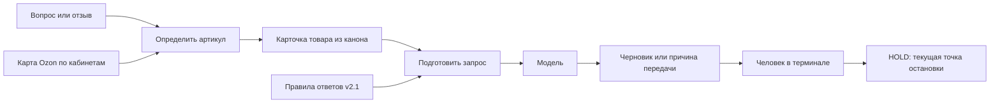

# Интро по Marketplace Reply Assistant

MRA — помощник продавца. Он получает вопрос или отзыв, находит именно этот товар, готовит ответ по знаниям Deppa и отдаёт его на проверку человеку. На тестовом этапе оператор работает в терминале. После приёмки планируется работа в фоне без отдельного интерфейса.

## Из каких частей он состоит

1. **Правила ответов** объясняют, как разговаривать: приветствие, тон, гарантийные процедуры, ограничения, когда передавать вопрос человеку. Это действующий файл v2.1 в `knowledge/ПРАВИЛА ОТВЕТОВ.md`.
2. **Канон** объясняет, что известно о товаре: свойства, комплект, совместимость, ограничения. В `knowledge/КАНОН ДЛЯ АГЕНТА.md` находятся 490 карточек. Для каждого ответа выбирается одна карточка по артикулу.
3. **Карта идентификаторов** переводит SKU Ozon в артикул Deppa. Один SKU в разных кабинетах рассматривается в контексте своего кабинета. В комплекте 1817 связей.
4. **Вход обращений** принимает JSON или читает текущие ревизии из SQLite старого коллектора. Прямой опрос API площадок в этом ядре отсутствует и не маскируется под работающий компонент.
5. **Генератор** передаёт модели правила, вопрос и материал выбранного товара. Модель должна вернуть либо текст с указанием использованного материала, либо пометку для человека. Сбой провайдера не заменяется фиктивным ответом.
6. **Операторский цикл** хранит состояния, черновики, версии источников и одобрения. В текущем коде одобрение заканчивается HOLD. Редактирование, отклонение и реальная отправка после одобрения входят в следующие приёмочные блоки.



## Пример: наушники 44167

Входной вопрос: «Как подключить эти наушники к телефону?». Артикул 44167 выбирает карточку модели Air Pro 2. Из неё в запрос попадает, в частности, исходная строка «Первое подключение». Правила v2.1 прикладываются целиком. Карточки других артикулов в этот запрос не включаются.

Команда для просмотра без вызова модели:

```bash
./mra-cli preview --article 44167 --question 'Как подключить эти наушники к телефону?'
```

Это просмотр входа модели, а не сгенерированный ответ. Для живой проверки требуется ключ и доступ провайдера. Один разрешённый вызов в этой сессии вернул HTTP 429; текст ответа получен не был.

## Что является источником истины

Содержание правил и канона принадлежит владельцу проекта. Код не дописывает факты и не пересобирает знания моделью. SQLite содержит производный индекс и журнал работы; исходный канон хранится отдельно и проверяется по SHA-256.

Подробнее: [контракт знаний](KNOWLEDGE.md), [приёмка по частям](ACCEPTANCE.md).
